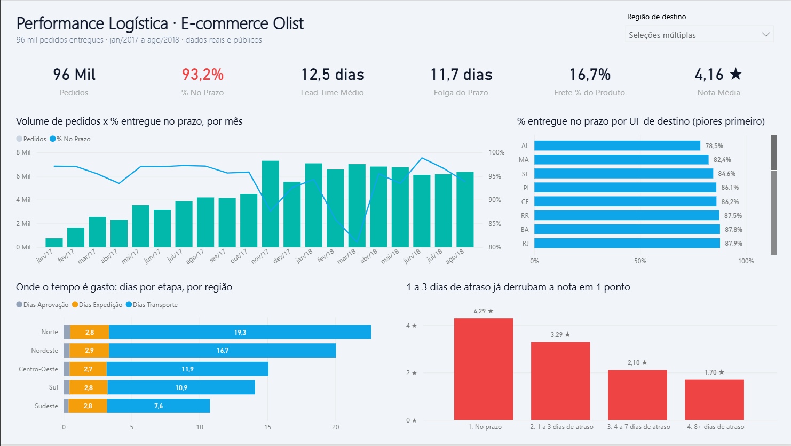
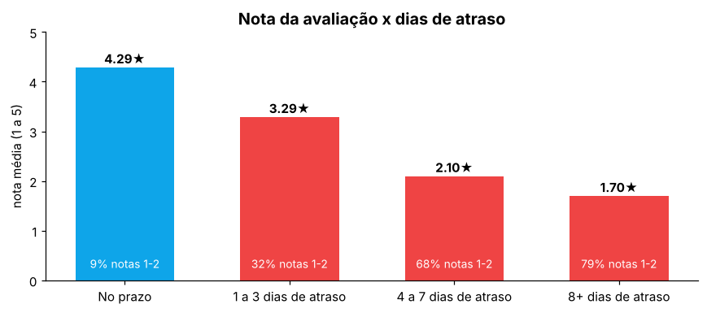
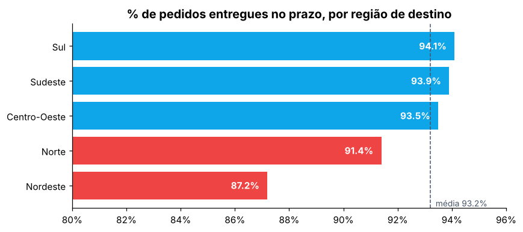
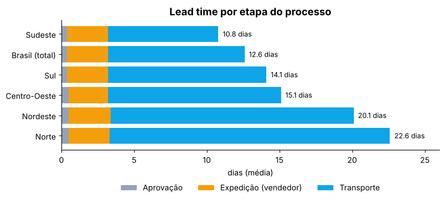
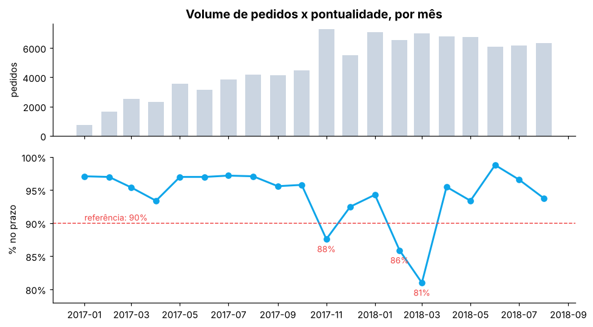

<h1 align="center">📦 Análise de Performance Logística · E-commerce Olist</h1>

<p align="center">
  
  
  
  
</p>

<p align="center"><b>Onde a entrega falha, quanto isso custa em satisfação e o que fazer a respeito.</b></p>

---

## 🎯 O problema

Em e-commerce, a experiência do cliente não termina no clique de compra. Ela termina quando o pacote
chega. Usando dados **reais** de ~96 mil pedidos entregues da Olist (jan/2017 a ago/2018), este projeto
responde a perguntas que um time de operações logísticas faria:

1. Qual o nível de serviço atual (pontualidade, lead time, frete)?
2. Quais regiões e estados concentram os atrasos?
3. Em qual etapa do processo o tempo é gasto?
4. Quanto o atraso impacta a avaliação do cliente?
5. O atraso nasce no vendedor ou no transporte?
6. Como a operação reage a picos de demanda?

> 💼 **Por que este tema:** venho da operação logística. Aqui uso dados para responder perguntas
> que eu via no dia a dia do chão de operação.

## 📊 Dashboard



Dashboard em Power BI com filtro por região: KPIs, evolução mensal, pontualidade por UF, tempo por
etapa do processo e nota x atraso. Arquivos e instruções em [`powerbi/`](powerbi/).

## 📌 Principais resultados

| Indicador | Valor |
|---|---|
| Pedidos analisados | **96.188** |
| Entregues no prazo (OTD) | **93,2%** |
| Lead time médio (compra → entrega) | **12,5 dias** |
| Prazo prometido médio | **24,3 dias** (folga de ~12 dias) |
| Frete / valor dos produtos | **16,7%** |
| Nota média de avaliação | **4,16 ★** |

### 1. Um atraso de 1 a 3 dias já derruba a nota em 1 ponto



Entregas no prazo têm nota **4,29**. Com 8+ dias de atraso, a nota cai para **1,70**, e **79%** desses
clientes dão nota 1 ou 2. **Pontualidade é o principal motor da satisfação.**

### 2. O Nordeste concentra os atrasos, e o RJ é um ponto fora da curva



O Nordeste entrega no prazo só **87,2%** das vezes, e 6 das 10 piores UFs estão lá (AL: 78,5%; MA: 82,4%).
No Sudeste, o **Rio de Janeiro** (87,9%, 12 mil pedidos) é o estado com mais atrasos em números absolutos.

### 3. O gargalo é o transporte, não o vendedor



A expedição do vendedor leva **~2,8 dias em todas as regiões**. A diferença está no **transporte**
(~74% do lead time), que vai de 7,6 dias no Sudeste a 19,3 dias no Norte.

### 4. A operação não acompanhou os picos de demanda



A pontualidade caiu para **87,6%** na Black Friday (nov/2017) e para **81%** em mar/2018.

### Outros achados
- Quando o vendedor **posta fora do prazo-limite**, a entrega no prazo cai de 94,6% para **78,9%**.
  Cerca de **28% dos atrasos** começam no vendedor.
- Vendas **interestaduais** levam quase o dobro do tempo (15,1 x 7,9 dias) e pagam mais frete
  proporcional (18,3% x 13,0%).

## 💡 Recomendações

| Achado | Recomendação |
|---|---|
| Atraso derruba a satisfação | Tratar pontualidade como KPI principal da experiência do cliente |
| Nordeste e RJ concentram atrasos | Revisar transportadoras/rotas; avaliar CD ou parceiro regional no Nordeste |
| Transporte é ~74% do lead time | Focar melhorias na malha de transporte para Norte e Nordeste |
| Postagem atrasada do vendedor | Monitorar e alertar vendedores que postam fora do prazo |
| Prazo prometido com ~12 dias de folga | Testar prazos mais precisos por região (pode aumentar a conversão) |
| Quedas em picos sazonais | Planejar capacidade logística antes de Black Friday e datas sazonais |

## 🛠️ Como foi feito

| Etapa | Ferramenta | Arquivo |
|---|---|---|
| Coleta dos dados | Python | [`scripts/baixar_dados.py`](scripts/baixar_dados.py) |
| Modelagem e limpeza (joins, regras de negócio, cálculo de etapas) | SQL | [`sql/01_base_entregas.sql`](sql/01_base_entregas.sql) |
| Consultas dos KPIs | SQL | [`sql/`](sql/) |
| Análise exploratória e gráficos | Python | [`notebooks/analise_logistica.ipynb`](notebooks/analise_logistica.ipynb) |
| Dashboard (modelo, medidas DAX e relatório) | Power BI | [`powerbi/`](powerbi/) · [como abrir](powerbi/GUIA_POWER_BI.md) |

**Definições usadas**
- **Entregue no prazo (OTD):** data de entrega ≤ data estimada informada ao cliente.
- **Lead time:** da compra até a entrega ao cliente.
- **Etapas:** aprovação (compra → pagamento aprovado) · expedição (aprovação → postagem pelo vendedor) ·
  transporte (postagem → entrega).

**Qualidade dos dados:** foram considerados apenas pedidos com status *entregue* e datas completas.
Cerca de 1,3% dos pedidos tinham datas inconsistentes (ex.: postagem antes da aprovação) e foram
excluídos da análise por etapas.

## ▶️ Como reproduzir

```bash
git clone https://github.com/RichardMelo-RD/analise-logistica-olist.git
cd analise-logistica-olist
pip install -r requirements.txt

python scripts/baixar_dados.py   # baixa os CSVs da Olist (~55 MB)
python scripts/rodar_sql.py      # roda as consultas e gera data/processed/base_entregas.csv
jupyter notebook notebooks/analise_logistica.ipynb
```

Para abrir o dashboard, siga [`powerbi/GUIA_POWER_BI.md`](powerbi/GUIA_POWER_BI.md).

## 📁 Estrutura

```
├── data/              # dados brutos e tratados (gerados pelos scripts, fora do Git)
├── images/            # gráficos usados neste README
├── notebooks/         # análise exploratória em Python
├── powerbi/           # dashboard Power BI (.pbip) e guia
├── scripts/           # download dos dados e execução do SQL
└── sql/               # modelagem e consultas dos KPIs
```

## ⚠️ Limitações

- A base não informa a transportadora nem o modal de transporte.
- A avaliação reflete a experiência completa, não só a entrega.
- Para pedidos com mais de um vendedor (~1,3%), foi considerado o vendedor do primeiro item.

## 📚 Fonte dos dados

[Brazilian E-Commerce Public Dataset by Olist](https://github.com/olist/work-at-olist-data): dados públicos
e anonimizados de pedidos reais (licença MIT).

---

<p align="center">
  Feito por <b>Richard Melo</b> ·
  <a href="https://www.linkedin.com/in/richard-melo-dados">LinkedIn</a> ·
  <a href="https://github.com/RichardMelo-RD">GitHub</a>
</p>
